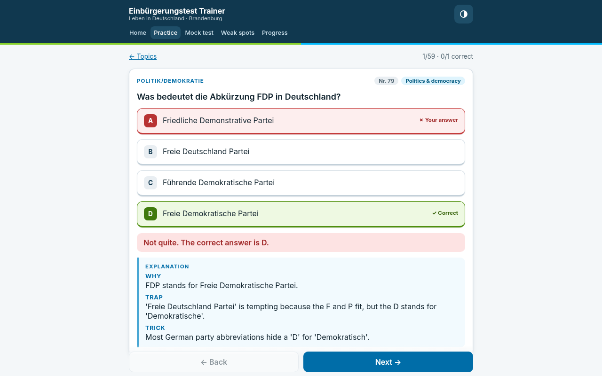

# Einbürgerungstest-Trainer (Brandenburg)

Live: [einbuergerung-trainer.vercel.app](https://einbuergerung-trainer.vercel.app)



## What I learned

- Data quality is the product. Every answer is checked against two independent sources, and a zod `superRefine` in `src/schema.ts` refuses `verified: true` unless both agree.
- Tests can guard content, not just code. `tests/questions.test.ts` checks all 310 questions for 4 distinct options, existing image files and a why/trap/trick explanation, and makes time-sensitive answers (who is in office, current figures) name the right answer with an "As of" date.
- Randomness should be testable. The mock test uses a small seeded PRNG (mulberry32) and a Fisher-Yates shuffle in `src/lib/random.ts`, so test composition is reproducible.
- Never throw away a user's progress. `src/lib/storage.ts` validates localStorage with zod and keeps corrupt data under a backup key instead of overwriting it.
- Accessibility is testable too. `tests/theme.test.ts` checks WCAG AA contrast for every theme, and the image lightbox has a focus trap and returns focus on close.

## Data

- `data/questions.json`: 300 general questions plus the 10 for Brandenburg. Question and option wording comes from the BAMF Gesamtfragenkatalog PDF (Stand 07.05.2025), with options in PDF order.
- `public/img/*.png`: pictures for the 13 image questions, cropped from the PDF.
- `src/schema.ts`: zod schema. `tests/questions.test.ts`: vitest checks (`npm test`).
- `CONFLICTS.md`: answer-key disagreements and the checks done by hand.

## Answer key
Each answer has to be confirmed by two sources, and every answer is mapped onto the PDF option order by matching option text, not position:
1. **BAMF Online-Testcenter** (`oet.bamf.de/ords/oetut/f?p=514:1`, Bundesland Brandenburg, 310 Aufgaben). The page HTML marks the correct option with `id="FARBE"`. Scraper: `scripts/scrape_oet.js`.
2. **einbuergerungstest-online.de** (`/fragen/1..10/` and `/fragen/bb`). The correct option is marked with ✅. Scraper: `scripts/scrape_eto.js`.

`verified: true` means both sources give the same answer.

## Rebuild
```
python3 scripts/extract_pdf.py /workspace/bamf.pdf   # -> raw/pdf_extract.json
python3 scripts/crop_images.py /workspace/bamf.pdf   # -> public/img, raw/images.json
NODE_PATH=... CHROME_PATH=... node scripts/scrape_oet.js   # -> raw/oet_brandenburg.json
NODE_PATH=... CHROME_PATH=... node scripts/scrape_eto.js   # -> raw/eto.json
python3 scripts/match_sources.py && python3 scripts/build_questions.py
npm test
```

## App (Batch 2)

Themes: Light, Dark blue and Dark grey (header half-circle button, or Progress > Appearance). The default follows the device (dark = Dark blue); the choice is stored in localStorage (`einb-trainer.theme.v1`, zod-validated) and applied before first paint by an inline script in index.html. All colours are CSS variables in src/index.css; tests/theme.test.ts checks WCAG AA contrast for every theme.

Pictures: tap or click any question picture (practice, weak questions, mock test and its review) to open it large in an accessible lightbox (role=dialog + aria-modal, focus trap, Esc / backdrop / × to close, focus returns to the picture). The picture sits on a white backing in every theme with its alt text as caption; pinch zoom is not blocked and the mock-test timer keeps running. Tests: tests/lightbox.test.tsx (jsdom + Testing Library).

Vite + React 18 + strict TypeScript, hash routing (wouter). Mobile-first; German question text, English UI.

- `npm run dev` (port 5181) · `npm run build` · `npm run preview` (port 4181) · `npm test`
- Pages: Home, Practice (by topic / Brandenburg / picture questions, instant feedback), Mock test
  (30 general + 3 Brandenburg, 60 min, pass mark 17, result + mistake review; survives reloads),
  Weak spots (list + practice until right twice in a row), Progress per topic.
- Progress is stored in `localStorage` (`einb-trainer.progress.v1`) and validated with zod; corrupt data is
  kept untouched under a `.backup-<timestamp>` key and the app starts fresh with a warning banner.
- Optional `explanation: { why?, trap?, trick? }` per question; shows "Explanation coming soon" when absent.
- PWA: `public/manifest.webmanifest` + icons (installable / add to home screen). No service worker yet (no offline cache).
